# 🚀 Awesome Digital Content Publishing

### 🌐 The Definitive Ecosystem of Digital Publishing Platforms, Headless CMS & Creator Infrastructure

  
  
  
  
  
  
  

  <b>A curated catalog of top SaaS platforms and open-source software powering the modern digital publishing ecosystem.</b> 
  <i>Covering Headless CMS, Managed WordPress Hosting, Creator Newsletters, Visual Site Builders, and Self-Hosted Publishing Engines.</i>

---

## 📌 Table of Contents
- [🎯 Executive Summary & SEO Keywords](#-executive-summary--seo-keywords)
- [📊 Sector Overview & Market Dynamics](#-sector-overview--market-dynamics)
- [☁️ SaaS & Hosted Platforms](#️-saas--hosted-platforms)
- [💻 Open-Source GitHub Projects](#-open-source-github-projects)
- [🤝 How to Contribute](#-how-to-contribute)
- [💖 Support & Sponsorship](#-support--sponsorship)
- [📈 Star History](#-star-history)
- [⚖️ Disclaimer](#️-disclaimer)

---

## 🎯 Executive Summary & SEO Keywords

Welcome to **Awesome Digital Content Publishing**—your open index and strategic guide to content infrastructure, enterprise publishing pipelines, and digital experience platforms (DXP). Whether you are an engineering team adopting a decoupled **API-first headless CMS**, a digital media outlet scaling enterprise **WordPress VIP hosting**, or an independent creator launching a monetization pipeline via **Substack** or **Ghost**, this directory indexes market scale, verified subscription pricing, developer APIs, and self-hosted open-source repositories.

> **Key Domain Concepts & Search Keywords:** Digital Content Publishing • Headless CMS • Composable DXP • Content Management System (CMS) • JAMstack Architecture • Open-Source Publishing Engine • Managed WordPress • Creator Economy Monetization • Static Site Generators (SSG) • Multi-Tenant Newsletters • REST & GraphQL Content APIs • Structured Content Modeling.

---

## 📊 Sector Overview & Market Dynamics

The global **digital content publishing and delivery software market** is estimated at **$170B–$180B**, while the specialized **headless and composable CMS** infrastructure market accounts for **$1B–$3.9B** and continues to expand rapidly at a compound annual growth rate (**CAGR of >20%**).

The competitive landscape demonstrates **moderate fragmentation**: established market leaders (such as Automattic/WordPress VIP, Contentful, Webflow, and Sanity) hold significant enterprise mindshare and capture approximately half of commercial software revenues, while a rich, highly active long tail of open-source frameworks, creator newsletters, and developer-centric headless backends thrives without a singular winner-take-all monopoly.

---

## ☁️ SaaS & Hosted Platforms

*Sorted in descending order by company scale (valuation or annual revenue).*

| Product | Scale (Valuation / Revenue) | Description | Starting Pricing | Free Tier / Trial Limits |
|---------|-----------------------------|-------------|------------------|--------------------------|
| **[Zoho Publish](https://www.zoho.com/publish/)** | **~$12.5B Valuation** (~$1.4B–$1.5B annual revenue) | Business listing and multi-location content publishing platform from the bootstrapped SaaS conglomerate. | From **$10/location/month** (1–10 locations) billed annually ($12/mo billed monthly) [citation:10] | **Free forever plan** (single-directory management, view-only analytics) or **14-day free trial** of full Professional tier without credit card [citation:10] |
| **[WordPress VIP](https://wpvip.com/)** | **~$7.5B Valuation** (Automattic parent company; ~$300M+ revenue) | Enterprise managed WordPress from Automattic with multi-site network support, CDN, and high-concurrency architecture. | From **~$2,000–$2,500/month** (billed annually as **$25,000/year** contract baseline) [citation:2][citation:12] | **No free tier**; 30-day guided enterprise sandbox / demo environment available upon sales approval |
| **[Webflow](https://webflow.com/)** | **$4.0B Valuation** (~$100M+ ARR) | Visual web development, responsive designer, and structured CMS platform. | From **$14/month** (Basic plan, billed annually) or **$23/month** (CMS plan, billed annually) [citation:5][citation:15] | **Free forever Starter plan**: 2 published pages, Webflow subdomain (.webflow.io), 50 CMS records, 1 GB bandwidth |
| **[Contentful](https://www.contentful.com/)** | **~$1.25B–$1.5B Valuation / Sale** (Peak $3.0B valuation; ~$100M ARR) | API-first headless content platform for omnichannel enterprise content operations. | From **$300/month** (Lite tier) [citation:6] | **Free forever Developer plan**: up to 10 users, 2 roles, 2 locales, 100,000 API calls/month, 50 GB CDN bandwidth, 1 Starter Space |
| **[Substack](https://substack.com/)** | **$1.1B Valuation** (~$37M revenue) | Creator newsletter and media publication network with integrated subscriptions. | **Free to publish**; takes **10% revenue share** of paid subscriber income + Stripe fees (2.9% + $0.30) [citation:3] | **Free forever plan**: unlimited free subscribers, full email newsletter delivery, web hosting, podcasts, and video posts |
| **[Sanity](https://www.sanity.io/)** | **~$500M–$1.0B Valuation** (Series C funded) | Composable content operating system featuring real-time collaborative Sanity Studio and GROQ/GraphQL APIs. | From **$15/seat/month** (Growth tier) plus metered usage overages [citation:7] | **Free forever plan**: up to 20 user seats, 2 datasets, 2,000 document attributes, 100,000 API requests/month, community support |
| **[Medium](https://medium.com/)** | **~$600M Valuation** (~$60M annual revenue) | Hosted social publishing and long-form blogging network with built-in readership distribution. | **Free to write and publish**; reader membership is **$5/month** or **$50/year** [citation:4] | **Free forever for writers**: publish unlimited articles, customize story formatting, and access standard engagement stats |
| **[Ghost (Pro)](https://ghost.org/)** | **~$11M ARR** (Non-profit foundation, bootstrapped) | Fully managed hosting for the open-source Ghost publishing system with bundled CDN, email delivery, and backups. | From **$9/month** (Starter, billed annually) or **$15/month** (billed monthly) [citation:1] | **14-day free trial** with full access to all Ghost(Pro) features, themes, and newsletter sending (no permanent free hosted tier) |
| **[ButterCMS](https://buttercms.com/)** | **~$2.5M ARR** (Acquired by Tiugo Technologies / PSG Equity) | API-first headless CMS and plug-and-play blog engine tailored for quick developer integration. | From **$99/month** (Micro tier, billed annually) [citation:9] | **Free forever plan**: 50,000 API calls/month, 100 GB bandwidth, 5 pages, 50 blog posts, 500 assets; **14-day free trial** on paid tiers [citation:9] |

---

## 💻 Open-Source GitHub Projects

*Sorted in descending order by GitHub stargazer count.*

| Project | Star Badge | Description |
|---------|------------|-------------|
| **[Strapi](https://github.com/strapi/strapi)** |  | **The leading open-source headless CMS.** Extensible Node.js/TypeScript architecture with customizable admin panel, REST and GraphQL APIs, and role-based permissions. Free under MIT License with unlimited content types and entries [citation:8]. |
| **[Ghost](https://github.com/TryGhost/Ghost)** |  | **The most complete open-source publishing platform.** Node.js engine for modern digital publishing, paid newsletters, and membership tiers. Self-hosted Ghost provides identical features to Ghost(Pro) without arbitrary content limits [citation:1]. |
| **[Payload](https://github.com/payloadcms/payload)** |  | **Next-generation TypeScript headless CMS and application framework.** Built natively on Next.js with code-first schema definitions, Postgres/MongoDB support, instant REST/GraphQL APIs, and deep React integration. |
| **[Directus](https://github.com/directus/directus)** |  | **Real-time API and App data platform for SQL databases.** Wraps any relational database with dynamic REST and GraphQL endpoints and an intuitive administrative interface for content publishers and developers. |
| **[WordPress](https://github.com/WordPress/WordPress)** |  | The open-source CMS powering **over 40% of the top 10 million websites**. Massive ecosystem of themes, Gutenberg block editor plugins, and REST API support [citation:12]. |
| **[Decap CMS](https://github.com/decaporg/decap-cms)** |  | **Open-source Git-based content management system** (formerly Netlify CMS). Stores all content directly in your Git repository alongside code, generating static content via automated CI/CD workflows. |
| **[Grav](https://github.com/getgrav/grav)** |  | **Modern flat-file CMS built on PHP.** Fast, simple, and flexible publishing platform requiring no database installation; content is authored in Markdown with Twig templating. |
| **[TinaCMS](https://github.com/tinacms/tinacms)** |  | **Git-backed headless CMS with real-time visual editing.** Enables content teams to edit Markdown and MDX pages directly in context while saving changes cleanly to Git. |
| **[Mithril CMS](https://github.com/GyroZepelix/mithril-cms)** |  | **Lightweight, schema-first headless CMS in a single Go binary.** Content types defined in YAML, React admin UI, PostgreSQL full-text search, JWT auth, and Docker Compose deployment with minimal footprint [citation:11]. |

---

## 🤝 How to Contribute

Contributions are warmly encouraged! Here is how to submit improvements:

1. 🍴 **Fork the repository** on GitHub.
2. 🌿 **Create a descriptive feature branch** (`git checkout -b add-publishing-tool`).
3. 📝 **Add or update entries in `README.md`**:
   - For SaaS platforms: include product name, official link, 1–2 sentence description, company scale, verified starting price, and exact free tier/trial limits.
   - For open-source projects: include project name, repository link, official stars badge (`style=social&color=white`), and core architectural highlights.
4. 🚀 **Submit a Pull Request (PR)** with a summary of the additions.

---

## 💖 Support & Sponsorship

If you find this curated directory helpful for evaluating digital publishing architecture or discovering open-source software, consider supporting the maintenance of this project!

- 🌟 **Star this repository** to help others discover it.
- 🍴 **Fork and contribute** your favorite publishing solutions.
- 📢 **Share with your network** on Twitter/X, LinkedIn, or developer forums.
- ☕ **Buy me a coffee / Sponsor**: If this resource helped you save engineering hours or procurement research, please consider sponsoring via the [GitHub Sponsors Dashboard](https://github.com/sponsors/ishandutta2007).

---

## 📈 Star History

---

## ⚖️ Disclaimer

- This is an **independent, community-curated list** provided for educational and architectural reference purposes—not an endorsement or formal vendor recommendation.
- Publishing architectures frequently process user credentials, subscriber newsletters, and subscription revenue. Always evaluate role-based access control (RBAC), end-to-end encryption, and regional privacy regulations (GDPR, CCPA) prior to production deployment.
- **Self-hosting considerations:** Self-hosting platforms like Ghost or Strapi offers data ownership, but total operating costs must incorporate compute instances, managed databases, transactional email gateways (e.g., Mailgun/SES), content delivery networks (CDNs), and maintenance overhead. Always audit Total Cost of Ownership (TCO) against managed SaaS offerings.

---

  <b>Built with ❤️ for digital publishers, media organizations, content engineers, and creator platforms worldwide.</b> 
  Maintained by <a href="https://github.com/ishandutta2007">@ishandutta2007</a> and the open-source community.

